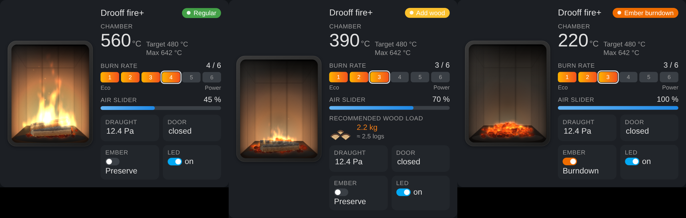

# Drooff fire+ integration for Home Assistant

A custom integration for [Home Assistant](https://www.home-assistant.io/) for the [Drooff fire+](https://www.drooff-kaminofen.de/en/nature/electronic-combustion-control-fire/) combustion control system.


## Installation

### HACS Installation

1. Ensure that [HACS](https://hacs.xyz) is installed.
2. Go to the HACS settings and add https://github.com/tehlers/ha-drooff-fireplus as a custom repository.
3. Search for "Drooff fire+" in HACS and install it.
4. Restart Home Assistant.

[](https://my.home-assistant.io/redirect/hacs_repository/?owner=tehlers&repository=ha-drooff-fireplus&category=integration)

### Manual Installation

1. Copy the directory `custom_components/drooff_fireplus` to `custom_components` in the `config` directory of your Home Assistant.
2. Restart Home Assistant.

## Configuration

1. Go to the Home Assistant dashboard.
2. Navigate to `Configuration` > `Devices & Services` > `Add Integration`.
3. Search for "Drooff fire+" and select it.
4. You will be prompted to enter the hostname used by your Drooff fire+ web application. In the default configuration, this is "fire".

If the fire+ keeps its default hostname "fire", Home Assistant usually discovers it automatically (DHCP) and offers to set it up under `Devices & Services`. When the fire+ was set up with its IP address, a changed IP address is picked up automatically.

Diagnostics (parsed values and the raw responses of the fire+, host and serial number removed) can be downloaded on the device page for bug reports.

## Entities

### Controls

| Name             | Type   | Description                                              |
| ---------------- | ------ | -------------------------------------------------------- |
| `Burn rate`      | Number | Select burn rate in six stages between "Eco" and "Power" (only "Eco" and "Power" for stoves with the Blue Angel label) |
| `Ember burndown` | Switch | Toggle between "Ember preservation" and "Ember burndown" |
| `LED`            | Switch | Toggle LED (only Drooff fire+ v1)                        |

Like the fire+ web application, the integration refuses changes while the fire+ is not controlled via web: with a remote control all settings are locked, with a room controller or when the panel on the stove is selected the burn rate is locked. See `Control` below.

### Sensors

| Name                      | Type   | Description                                                   |
| ------------------------- | ------ | ------------------------------------------------------------- |
| `Air slider position`     | Sensor | Position of the air slider in percent                         |
| `Draught`                 | Sensor | Chimney draught in Pa                                         |
| `Heating progress`        | Sensor | Heating progress in percent (only available while `HEATING`)  |
| `Operation status`        | Sensor | Operation status of the fireplace. Possible values are:<br>- `STANDBY`<br>- `REGULAR`<br>- `HEATING`<br>- `WOOD_REQUIRED`<br>- `WOOD_URGENTLY_REQUIRED`<br>- `EMBER_PRESERVATION`<br>- `EMBER_BURNDOWN`<br>- `ERROR`<br>- `UNKNOWN` |
| `Temperature`             | Sensor | Temperature inside the combustion chamber in °C               |
| `Target temperature`      | Sensor | Target Temperature inside the combustion chamber in °C        |
| `Recommended wood load`   | Sensor | Recommended amount of wood to add in kg (only recent devices) |
| `Door`                    | Sensor | Door contact switch indicator                                 |
| `Door open too long`      | Binary Sensor | Problem when the door is open for more than 5 minutes while the temperature is above 40 °C, like the warning of the web app (only recent devices) |
| `Filter status`           | Sensor | Status of the OekoSolve particle filter: `driver_error`, `not_found`, `present`, `inactive`, `active`, `cleaning_required` or `error` (only stoves with the Blue Angel label) |
| `Filter problem`          | Binary Sensor | Problem when the web app shows the filter status in red: driver error, filter not found, cleaning required or another error (only stoves with the Blue Angel label) |

### Statistics

The integration reads the event log of the fire+ (door openings and phases, `php/easevents.php`) once a minute and keeps the counters across restarts. They are `total_increasing`, so the statistics graph card or a utility meter shows them per day, week or month.

| Name                           | Type   | Description |
| ------------------------------ | ------ | ----------- |
| `Fires`                        | Sensor | Fires: heating up followed by regular operation (heating up that ends in standby is not counted) |
| `Reloads`                      | Sensor | Door openings during regular operation; openings within 10 minutes count once |
| `Wood consumption (estimated)` | Sensor | Recommended wood load at every fire and reload, in kg. An estimate, the fire+ does not weigh the wood (only recent devices) |
| `Last reload`                  | Sensor | Time of the last reload |

On the first start the counters include the events still stored on the fire+ (usually the last days). Older firmware without event log leaves these sensors unavailable.

### Configuration

| Name         | Type   | Description                                                     |
| ------------ | ------ | --------------------------------------------------------------- |
| `Brightness` | Number | Brightness of the LED strip in percent                          |
| `Volume`     | Number | Volume of the acoustic signal in percent (only Drooff fire+ v2) |

### Diagnostic

Entities that are rarely needed or that write many values to the database are disabled by default. Enable them on the device page under *Diagnostic*.

| Name                   | Type          | Description                                                       |
| ---------------------- | ------------- | ----------------------------------------------------------------- |
| `Error`                | Binary Sensor | Active when an error has been detected                            |
| `Error message`        | Sensor        | Description of the detected error. Possible values are:<br>- "No error"<br>- "Temperature sensor defective"<br>- "Pressure measurement defective"<br>- "Air slider defective"<br>- "Service mode enabled"<br>- "Chimney draught too low"<br>- "Air slider stuck"<br>- "No chimney draught"<br>- "Wrong motor direction"<br>- "Unknown error"<br><br>**Always consult the official fire+ web application in the event of an error!** |
| `Operating time`       | Sensor        | Total operating time of the fireplace in s (only Drooff fire+ v2). Disabled by default |
| `Wifi signal strength` | Sensor        | Strength of the Wifi signal (only Drooff fire+ v2). Disabled by default |
| `Ethernet link`        | Binary Sensor | Network is connected via Ethernet (only Drooff fire+ v2). Disabled by default |
| `Control`              | Sensor        | Who controls the fire+: `web`, `panel`, `remote_control`, `remote_control_automatic` or `room_controller` (only Drooff fire+ v2) |
| `Online support`       | Binary Sensor | Remote access for Drooff support is enabled (recent web applications). Disabled by default |
| `Automatic updates`    | Binary Sensor | The fire+ installs updates automatically (recent web applications). Disabled by default |
| `Draught warning`      | Binary Sensor | The draught warning of the fire+ is enabled (recent web applications) |
| `Web app version`      | Sensor        | Version of the fire+ web application (recent web applications). Disabled by default |
| `Last update`          | Sensor        | Result of the last software update: `no_updates`, `started`, `running`, `successful`, `failed`, `postponed` (until the stove is off), `not_started` or `unknown`. The message of the fire+ (German) is an attribute. Disabled by default, read once a minute while enabled |
| `Update search`        | Sensor        | When the fire+ looks for updates every week, e.g. "Mittwoch, 03:43 Uhr". Disabled by default |

## Dashboard card

The integration ships a Lovelace card with an animated fire that follows the current combustion state, next to the values and controls of the fire+. The card is registered automatically, no resource has to be added. Edit a dashboard, choose *Add card* and pick **Drooff fire+ Card**, or use YAML:

```yaml
type: custom:drooff-fireplus-card
```

The card editor detects the fire+ device and its entities automatically. Every value can be hidden, a picture of your own stove can be used, and optional graphics (temperature history, timeline, wood usage, draught gauge) can be enabled. All options are described in the [card documentation](docs/dashboard-card.md) ([Deutsch](docs/dashboard-card.de.md)).



## Blueprint: wood reminder

The integration installs the automation blueprint **Drooff fire+: Holz nachlegen / Add wood** to `blueprints/automation/drooff_fireplus/` once Home Assistant has started, and updates it with every new version of the integration. Go to *Settings*, *Automations & scenes*, *Blueprints* and create an automation from it.

It reminds you when the fire+ asks for wood. *Wood required* and *wood urgently required* get separate actions, the urgent ones are optional and hidden in their own section. Each kind of reminder can be sent as a message (Pushover, Telegram, mobile app or any other notify action or entity), as an announcement on Amazon Echo devices (Alexa Media Player or Alexa Devices) and as any other actions. Every channel is optional and has its own delay, and nothing is sent once the wood has been added. Details are in the [blueprint documentation](docs/blueprint.md) ([Deutsch](docs/blueprint.de.md)).

The blueprint is labelled in German and English, its default texts follow the selected language (German or English). Local changes to the installed file are overwritten on updates, copy it under another name to customise it.

## Disclaimer

> [!IMPORTANT]
> This integration is neither supported nor affiliated with Drooff. It is intended as a supplement to the official fire+ webapp and not a full replacement.
