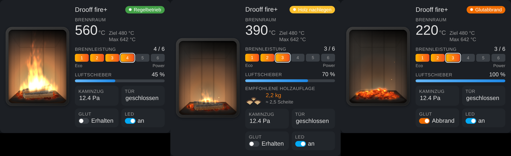
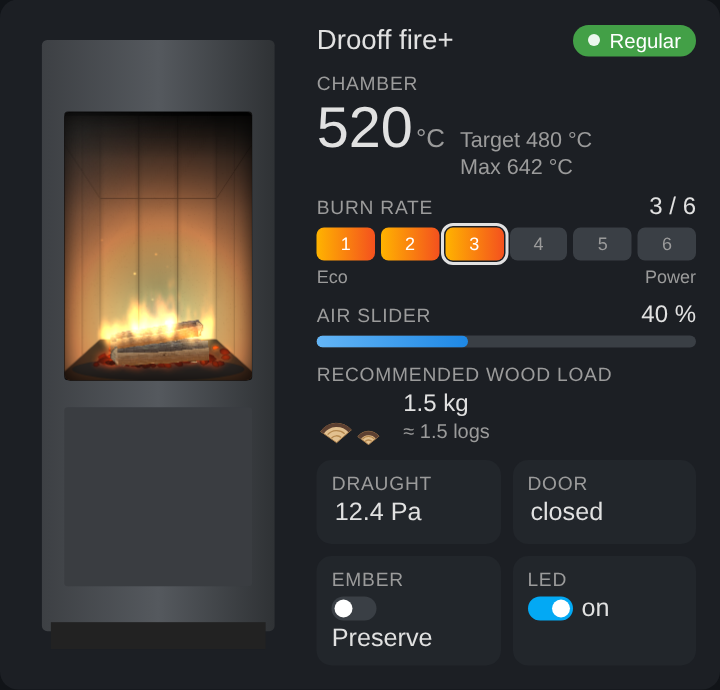
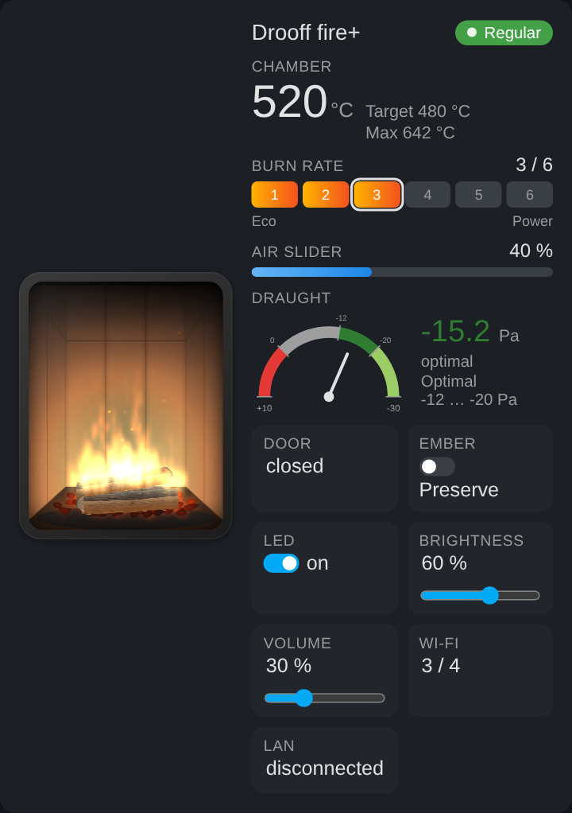
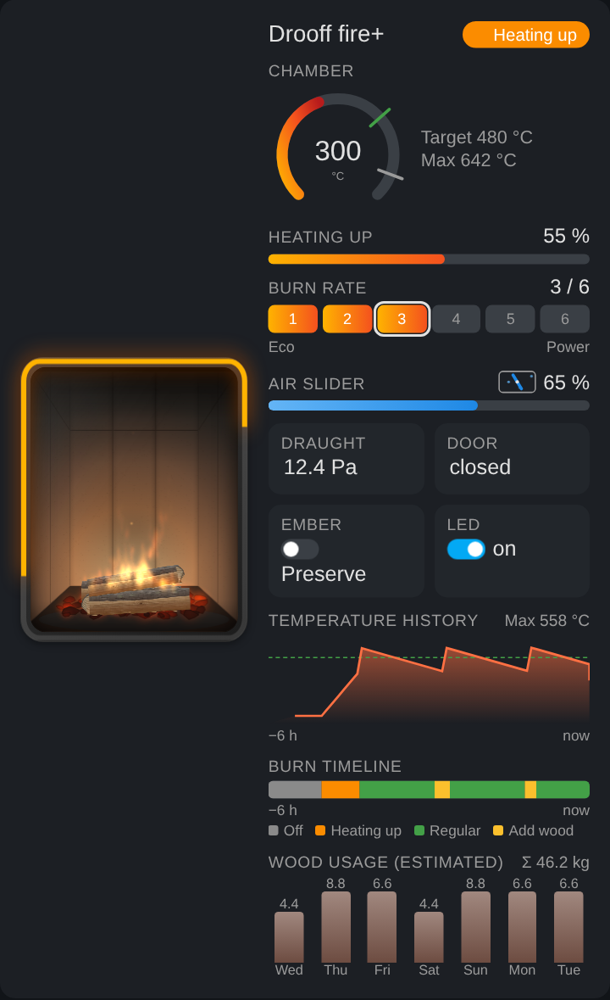

# Drooff fire+ Card

[← Zurück zur Integration](../README.md)

Eine Dashboard-Card für die Home-Assistant-Integration [Drooff fire+](https://github.com/tehlers/ha-drooff-fireplus). Sie zeigt ein animiertes Feuer, dessen Größe dem aktuellen Abbrandzustand folgt, neben den Werten und Bedienelementen der fire+ Abbrandsteuerung.

**[English documentation](dashboard-card.md)**



## Funktionen

- **Realistische Flammenanimation** (Partikelsystem auf Canvas mit Flammenzungen und Funkenflug) in einem Brennraum aus **hochkant stehenden weißen Schamotteplatten**, mit Seitenwänden in Perspektive, Rußspuren und flackerndem Feuerschein. Alternativ wählbar: helle oder dunkle Mauer.
- **Spaltholz**: 25 cm lange Buchenscheite mit Rinde, Fasern, Ästen und Jahresringen. Sie verkohlen und glühen beim Abbrand. Das Feuer folgt der Brennraumtemperatur und dem Betriebsstatus:
  - *Aus*: kalte Scheite, bei Restwärme leichte Restglut
  - *Anheizen*: Flamme wächst mit dem Anheizfortschritt
  - *Regelbetrieb*: Flammengröße nach Temperatur
  - *Holz nachlegen / dringend*: kleinere Flamme, verkohlte Scheite
  - *Gluterhaltung*: dunkelrot, langsam atmendes Glutbett ohne Flammen
  - *Glutabbrand*: hell glühendes Glutbett mit kleinen Flämmchen und Funken
- Tür offen: gestrichelter, pulsierender Rahmen um die Scheibe
- Betriebsstatus als farbiges Badge, Fehlermeldung als Banner
- Temperatur mit Ziel- und Maximaltemperatur, Anheizfortschritt, Luftschieber, Kaminzug
- **Empfohlene Holzauflage als Holzscheite** (Stapel gespaltener Scheite, ein halbes Scheit wird kleiner gezeigt)
- **Optional: Bild deines Ofens**, das Feuer erscheint dann in seinem Sichtfenster (Standard ist die Feuerstelle)
- **Ofenmodell-Auswahl** für alle Drooff-Öfen mit fire+: übernimmt den optimalen Zugbereich und verlinkt die Produktseite mit Anleitung fürs Bild
- Brennleistung (1–6 bzw. 1–7) und Glutabbrand direkt in der Card bedienbar (`controls: false` schaltet das ab)
- Einstellungen und Diagnosewerte des fire+: LED an/aus, LED-Helligkeit und Lautstärke (mit Schieberegler), WLAN-Signal, LAN-Verbindung, Betriebszeit
- **Automatische Erkennung**: Der Card-Editor findet das fire+ Gerät und alle Entitäten und hakt unter „Anzeigen“ alles vor, was dein Gerät liefert. Abwählen blendet den Wert aus. Unter „Entitäten“ steht die erkannte Zuordnung, die sich ändern lässt.
- **Kaminzug als Zeigerinstrument** (optional): Skala von +10 Pa (links) bis −30 Pa (rechts). Die fire+ meldet den Zug als Unterdruck, negative Werte sind also gut. Bereiche: +10 bis 0 rot (Überdruck), 0 bis −12 grau (schwacher Zug), −12 bis −20 dunkelgrün (optimal), −20 bis −30 hellgrün (OK, starker Zug). Alles einstellbar unter „Erweitert: Kaminzug“
- **Zusätzliche Grafiken** (einzeln wählbar, standardmäßig aus):
  - `temp_history` Temperaturverlauf der letzten Stunden mit Ziellinie (aus der HA-Historie)
  - `timeline` Abbrand-Zeitleiste als farbiges Band mit Legende
  - `wood_usage` geschätzter Holzverbrauch pro Tag (jedes Anheizen/Nachlegen zählt als Ladung mit der damals empfohlenen Holzauflage, sonst `wood_per_load`)
  - `heating_ring` leuchtender Fortschrittsring um die Scheibe beim Anheizen
  - `air_flap` Luftschieber als animierte Klappe
  - `temp_ring` Temperatur als Ring mit Ziel- und Max-Markierung
- **Feuer simulieren**: Button im Card-Editor, spielt in der Vorschau einmal alle Phasen durch, ohne den Ofen zu verändern
- **Sprachen**: Deutsch, Englisch, Niederländisch, Französisch, Italienisch, Polnisch, Tschechisch, Dänisch – automatisch nach Benutzersprache oder fest eingestellt (`language`). Weitere Sprachen über einen eigenen Sprachcode und `translations`.
- Die Card-Version steht unten im Card-Editor
- Die Animation pausiert, wenn die Card nicht sichtbar ist

## Installation

Die Karte gehört zur Integration Drooff fire+ und wird automatisch geladen, sobald die Integration installiert ist. Es muss keine Ressource eingetragen und kein eigener HACS-Eintrag angelegt werden.

Danach Dashboard bearbeiten → *Karte hinzufügen* → **Drooff fire+ Card**, oder per YAML:

```yaml
type: custom:drooff-fireplus-card
```

Alles Weitere wird automatisch erkannt.

## Optionen

| Option | Standard | Beschreibung |
| --- | --- | --- |
| `title` | Gerätename | Überschrift |
| `language` | `auto` | `auto` (Benutzersprache), `de`, `en`, `nl`, `fr`, `it`, `pl`, `cs`, `da` oder ein eigener Code (z. B. `es`) |
| `translations` | – | Eigene Texte, überschreiben die eingebauten; fehlende Texte fallen auf Englisch zurück (siehe [Vorlage](examples/translations-template.yaml)) |
| `device` | erstes fire+ Gerät | Geräte-ID, nur bei mehreren Öfen nötig |
| `min_temperature` | `80` | Brennraumtemperatur, unter der keine Flamme gezeigt wird (°C) |
| `max_temperature` | `600` | Temperatur für die volle Flamme (°C) |
| `log_weight` | `0.9` | Gewicht eines Holzscheits in kg (Umrechnung der Holzauflage in Scheite) |
| `wall` | `chamotte` | Brennraum-Hintergrund: `chamotte` (Schamotteplatten hochkant), `bricks_light` (Mauer hell), `bricks_dark` (Mauer dunkel) |
| `stove_image` | – | Bild des Ofens (Dateiauswahl im Editor oder URL wie `/local/ofen.png`). Ohne Bild wird die Feuerstelle gezeigt |
| `stove_model` | – | Drooff-Modell, setzt im Editor den optimalen Zugbereich: `andalo3s`, `andalo3m`, `andalo3l`, `aprica2`, `arola`, `brunello2s`, `brunello2m`, `brunello2l`, `catania`, `forano`, `garda`, `imola`, `livera2m`, `livera2l`, `liverapm`, `liverapl`, `varese3`, `varese3w` |
| `stove_window` | `{left: 20, top: 20, width: 60, height: 40}` | Lage des Sichtfensters im Bild in Prozent der Breite/Höhe |
| `stove_window_radius` | `4` | Eckenradius des Sichtfensters in px |
| `stove_window_debug` | `false` | Zeigt das Sichtfenster als roten Rahmen zum Ausrichten |
| `draught_display` | `tile` | Kaminzug als `tile` (Kachel) oder `gauge` (Zeigerinstrument) |
| `draught_min` / `draught_max` | `-30` / `10` | Skala des Gauges in Pa (starker Zug rechts, Überdruck links) |
| `draught_optimal_from` / `draught_optimal_to` | `-12` / `-20` | Optimaler Bereich in Pa (dunkelgrün). Zwischen 0 und `draught_optimal_from` grau, jenseits von `draught_optimal_to` hellgrün, über 0 rot |
| `graphics` | `[]` | Zusatzgrafiken: `temp_history`, `timeline`, `wood_usage`, `heating_ring`, `air_flap`, `temp_ring` |
| `history_hours` | `6` | Zeitraum für Temperaturverlauf und Zeitleiste in Stunden |
| `wood_days` | `7` | Anzahl Tage beim Holzverbrauch |
| `wood_per_load` | `2` | kg pro Ladung, falls kein Holzauflage-Sensor vorhanden ist |
| `controls` | `true` | Brennleistung, Glutabbrand, LED, Helligkeit und Lautstärke in der Card bedienbar |
| `layout` | `auto` | `auto` (schmal = untereinander), `horizontal`, `vertical` |
| `hide` | `[brightness, volume, wifi, ethernet]` | Ausgeblendete Elemente, siehe unten |
| `entities` | automatisch | Entitäten manuell zuordnen, z. B. `temperature: sensor.kamin_temperatur` |
| `flame_intensity` | – | Flammengröße fest vorgeben (0–1), z. B. zum Testen |

Ohne `hide` sind LED-Helligkeit, Lautstärke, WLAN und LAN ausgeblendet, alles andere ist sichtbar; `hide: []` zeigt alles. Werte für `hide`: `flame`, `name`, `status`, `temperature`, `target_temperature`, `max_temperature`, `heating_progress`, `burn_rate`, `air_slider`, `draught`, `wood_load`, `wood_logs` (nur die Scheite-Grafik), `door`, `ember_burndown`, `error`, `operating_time`, `led`, `brightness`, `volume`, `wifi`, `ethernet`.

Schlüssel für `entities`: `operation_status`, `temperature`, `target_temperature`, `heating_progress`, `air_slider_position`, `draught`, `weight`, `error_message`, `operating_time`, `burn_rate`, `ember_burndown`, `error`, `door_open`, `led`, `brightness`, `volume`, `wifi_signal_strength`, `ethernet_link`.

Werte, die der Ofen nicht liefert (z. B. Holzauflage bei älteren Geräten, Anheizfortschritt außerhalb des Anheizens), werden automatisch ausgeblendet.

Ein komplettes Dashboard-Beispiel steht in [examples/dashboard.de.yaml](examples/dashboard.de.yaml).

## Bild des eigenen Ofens



1. Card bearbeiten, im Abschnitt **Ofenbild** auf **Bild auswählen …** klicken und ein Frontalfoto deines Ofens wählen (am besten mit weißem Hintergrund, z. B. das Produktbild des Herstellers).
2. Die Card verkleinert das Bild, macht den weißen Hintergrund transparent, schneidet es auf den Ofen zu und **erkennt das Sichtfenster automatisch**. Die rote Markierung zeigt, wo das Feuer erscheint.
3. Falls nötig unter **Sichtfenster** (Links/Oben/Breite/Höhe in Prozent, Eckenradius) nachjustieren.
4. **Entfernen** schaltet zurück auf die Feuerstelle.

Das Bild wird in der Card-Konfiguration gespeichert (typisch 10–60 KB), es muss nichts nach `/config/www` kopiert werden. Eine URL geht ebenfalls:

```yaml
stove_image: /local/ofen.png
stove_window: { left: 12, top: 37, width: 70, height: 27 }
stove_window_radius: 6
```

Bitte nur Bilder verwenden, die du nutzen darfst; Produktfotos sind in der Regel urheberrechtlich geschützt.

## Ofenmodell

Unter **Ofenbild → Ofenmodell (Drooff)** wählst du dein Drooff-Modell aus (alle Holz-Kaminöfen, die fire+ unterstützen). Die Karte übernimmt dann den optimalen Zugbereich des Modells: vom Mindestförderdruck (bei allen aktuellen Modellen 12 Pa) bis −20 Pa, ab dem Drooff einen Zugbegrenzer vorschreibt. Unter „Erweitert: Kaminzug“ lassen sich die Werte weiter anpassen.

Außerdem zeigt die Karte einen Link zur Produktseite bei Drooff und erklärt, wie das Bild in die Karte kommt:

1. Produktseite öffnen und die gewünschte Ausführung wählen.
2. Das freigestellte Produktbild (Ofen ohne Hintergrund) mit Rechtsklick → „Bild speichern unter …“ auf deinem Gerät speichern.
3. Im Karten-Editor **Bild auswählen …** klicken und die Datei wählen. Der Hintergrund wird entfernt und die Scheibe automatisch erkannt.

Die Produktbilder sind urheberrechtlich geschützt (© Drooff). Deshalb lädt die Karte sie nicht selbst herunter und liefert sie nicht mit; bitte nur privat im eigenen Dashboard verwenden. Modellliste und Zugwerte stammen aus Katalog und technischen Informationen von Drooff und können veraltet sein; maßgeblich ist immer die technische Dokumentation deines Ofens.

```yaml
stove_model: brunello2l
```

## Kaminzug als Zeigerinstrument



## Zusätzliche Grafiken



`temp_history`, `timeline` und `wood_usage` lesen die Home-Assistant-Historie (Recorder) und werden alle 5 Minuten aktualisiert. Der Holzverbrauch ist eine Schätzung.

## Eigene Sprache

Im Card-Editor unter **Sprache** einen eigenen Code eintippen (z. B. `es`) und die Texte unter **Erweitert: Sprache / eigene Übersetzung** eintragen. Per YAML:

```yaml
type: custom:drooff-fireplus-card
language: es
translations:
  temperature: Cámara de combustión
  burn_rate: Potencia
  status:
    REGULAR: Funcionamiento normal
    WOOD_REQUIRED: Añadir leña
```

[examples/translations-template.yaml](examples/translations-template.yaml) enthält alle Schlüssel mit den englischen Texten, [examples/translations-example-de.yaml](examples/translations-example-de.yaml) zeigt eine komplette Übersetzung am Beispiel Deutsch. `translations` funktioniert auch mit eingebauten Sprachen, um einzelne Texte anzupassen. Pull Requests mit neuen Sprachen sind willkommen.

## Hinweis

Diese Card wird von Drooff weder unterstützt noch steht sie mit Drooff in Verbindung. Drooff und fire+ sind Marken ihres jeweiligen Inhabers.

## Lizenz

Siehe [LICENSE](../LICENSE).
