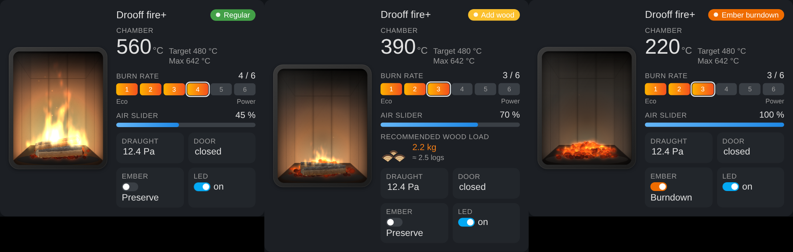
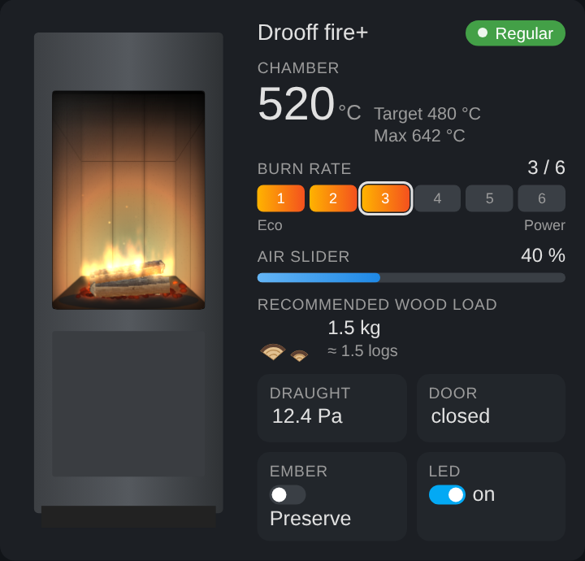
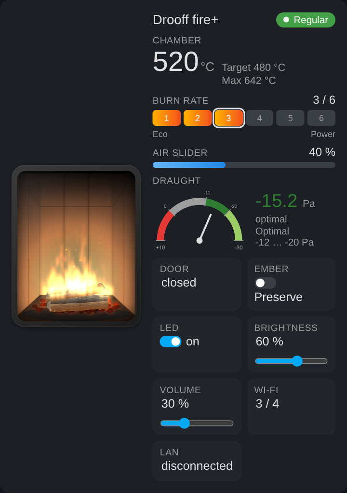
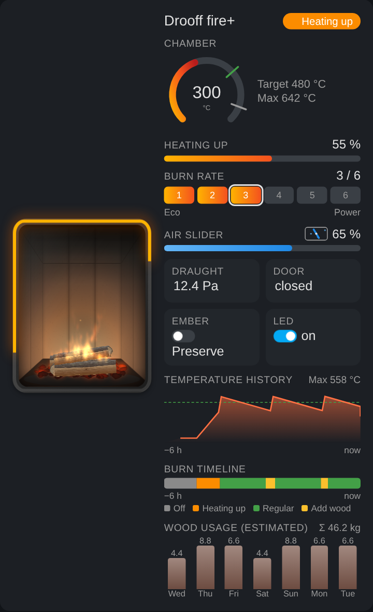

# Drooff fire+ Card

[← Back to the integration](../README.md)

A Lovelace dashboard card for the Home Assistant integration [Drooff fire+](https://github.com/tehlers/ha-drooff-fireplus). It shows an animated fire whose size follows the current combustion state, next to the values and controls of the fire+ combustion control.

**[Deutsche Anleitung](dashboard-card.de.md)**



## Features

- **Realistic fire animation** (canvas particle system with flame tongues and sparks) in a combustion chamber lined with **upright white fire-clay plates**, side walls in perspective, soot marks and flickering firelight. Light or dark brick walls can be selected instead.
- **Split firewood**: 25 cm beech logs with bark, fibres, knots and growth rings. They char and glow while burning. The fire follows the chamber temperature and the operation status:
  - *Off*: cold logs, faint embers while the stove is still warm
  - *Heating up*: the flame grows with the heating progress
  - *Regular*: flame size according to the temperature
  - *Add wood / add wood now*: smaller flame, charred logs
  - *Ember preservation*: dark red, slowly breathing ember bed without flames
  - *Ember burndown*: bright glowing embers with small flames and sparks
- Door open: dashed, pulsing frame around the window
- Operation status as coloured badge, error message as banner
- Temperature with target and maximum, heating progress, air slider, chimney draught
- **Recommended wood load shown as logs** (stack of split logs, half a log is drawn smaller)
- **Optional: a picture of your stove** – the fire is then shown inside its window (default is the open fireplace)
- **Stove model selection** for all Drooff fire+ stoves: applies the optimal draught range and links to the product page with instructions for the picture
- Burn rate (1–6 or 1–7) and ember burndown can be changed directly in the card (`controls: false` turns this off)
- Settings and diagnostics of the fire+: LED on/off, LED brightness and volume (with slider), Wi-Fi signal, Ethernet link, operating time
- **Automatic detection**: the card editor finds the fire+ device and all of its entities and preselects everything your device provides under “Show”. Unticking hides the value. The detected entities are listed under “Entities” and can be changed.
- **Chimney draught as gauge** (optional): scale from +10 Pa (left) to −30 Pa (right). The fire+ reports the draught as negative pressure, so negative values are good. Zones: +10 to 0 red (overpressure), 0 to −12 grey (weak draught), −12 to −20 dark green (optimal), −20 to −30 light green (OK, strong draught). Everything adjustable under “Advanced: draught”
- **Additional graphics** (each optional, off by default):
  - `temp_history` temperature history of the last hours with target line (from the HA recorder)
  - `timeline` burn timeline as coloured band with legend
  - `wood_usage` estimated wood usage per day (every heating up / adding wood counts as one load with the wood load recommended at that time, otherwise `wood_per_load`)
  - `heating_ring` glowing progress ring around the window while heating up
  - `air_flap` air slider as animated damper flap
  - `temp_ring` temperature as ring with target and maximum markers
- **Simulate fire**: button in the card editor that plays all phases once in the preview without touching the stove
- **Languages**: German, English, Dutch, French, Italian, Polish, Czech, Danish – automatically from the user language or fixed (`language`). Any other language can be added with your own language code and `translations`.
- Card version is shown at the bottom of the card editor
- The animation pauses while the card is not visible

## Installation

The card is part of the Drooff fire+ integration and is loaded automatically once the integration is installed. No resource has to be added and HACS does not need a separate entry.

Then edit a dashboard → *Add card* → **Drooff fire+ Card**, or in YAML:

```yaml
type: custom:drooff-fireplus-card
```

Everything else is detected automatically.

## Options

| Option | Default | Description |
| --- | --- | --- |
| `title` | device name | Heading |
| `language` | `auto` | `auto` (user language), `de`, `en`, `nl`, `fr`, `it`, `pl`, `cs`, `da` or any own code (e.g. `es`) |
| `translations` | – | Own texts that override the built-in ones; missing texts fall back to English (see [template](examples/translations-template.yaml)) |
| `device` | first fire+ device | Device id, only needed with several stoves |
| `min_temperature` | `80` | Chamber temperature below which no flame is shown (°C) |
| `max_temperature` | `600` | Temperature for the full flame (°C) |
| `log_weight` | `0.9` | Weight of one log in kg (converts the wood load into logs) |
| `wall` | `chamotte` | Chamber background: `chamotte` (upright fire-clay plates), `bricks_light`, `bricks_dark` |
| `stove_image` | – | Picture of the stove (file picker in the editor, or a URL like `/local/stove.png`). Without it the open fireplace is shown |
| `stove_model` | – | Drooff model, sets the optimal draught range in the editor: `andalo3s`, `andalo3m`, `andalo3l`, `aprica2`, `arola`, `brunello2s`, `brunello2m`, `brunello2l`, `catania`, `forano`, `garda`, `imola`, `livera2m`, `livera2l`, `liverapm`, `liverapl`, `varese3`, `varese3w` |
| `stove_window` | `{left: 20, top: 20, width: 60, height: 40}` | Position of the window in the picture, in percent of width/height |
| `stove_window_radius` | `4` | Corner radius of the window in px |
| `stove_window_debug` | `false` | Shows the window as red frame for alignment |
| `draught_display` | `tile` | Chimney draught as `tile` or `gauge` |
| `draught_min` / `draught_max` | `-30` / `10` | Gauge scale in Pa (strong draught on the right, overpressure on the left) |
| `draught_optimal_from` / `draught_optimal_to` | `-12` / `-20` | Optimal range in Pa (dark green). Between 0 and `draught_optimal_from` is grey, beyond `draught_optimal_to` light green, above 0 red |
| `graphics` | `[]` | Additional graphics: `temp_history`, `timeline`, `wood_usage`, `heating_ring`, `air_flap`, `temp_ring` |
| `history_hours` | `6` | Time span of temperature history and timeline in hours |
| `wood_days` | `7` | Number of days for the wood usage |
| `wood_per_load` | `2` | kg per load if there is no wood load sensor |
| `controls` | `true` | Burn rate, ember burndown, LED, brightness and volume can be changed in the card |
| `layout` | `auto` | `auto` (narrow = stacked), `horizontal`, `vertical` |
| `hide` | `[brightness, volume, wifi, ethernet]` | Hidden elements, see below |
| `entities` | automatic | Assign entities manually, e.g. `temperature: sensor.stove_temperature` |
| `flame_intensity` | – | Fixed flame size (0–1), e.g. for testing |

Without `hide`, LED brightness, volume, Wi-Fi and Ethernet are hidden and everything else is shown; `hide: []` shows everything. Values for `hide`: `flame`, `name`, `status`, `temperature`, `target_temperature`, `max_temperature`, `heating_progress`, `burn_rate`, `air_slider`, `draught`, `wood_load`, `wood_logs` (only the log graphic), `door`, `ember_burndown`, `error`, `operating_time`, `led`, `brightness`, `volume`, `wifi`, `ethernet`.

Keys for `entities`: `operation_status`, `temperature`, `target_temperature`, `heating_progress`, `air_slider_position`, `draught`, `weight`, `error_message`, `operating_time`, `burn_rate`, `ember_burndown`, `error`, `door_open`, `led`, `brightness`, `volume`, `wifi_signal_strength`, `ethernet_link`.

Values your stove does not provide (e.g. wood load on older devices, heating progress outside of heating up) are hidden automatically.

A complete dashboard example is in [examples/dashboard.yaml](examples/dashboard.yaml).

## Picture of your stove



1. Edit the card, click **Choose picture …** in the section **Stove picture** and select a front photo of your stove (white background works best, e.g. the product picture of the manufacturer).
2. The card scales the picture down, makes a white background transparent, crops it to the stove and **detects the window automatically**. The red marker in the preview shows where the fire will appear.
3. Fine-tune under **Window** (left/top/width/height in percent, corner radius) if necessary.
4. **Remove** switches back to the open fireplace.

The picture is stored in the card configuration (typically 10–60 KB), nothing has to be copied to `/config/www`. A URL works as well:

```yaml
stove_image: /local/stove.png
stove_window: { left: 12, top: 37, width: 70, height: 27 }
stove_window_radius: 6
```

Please only use pictures you are allowed to use; product photos are usually copyrighted by the manufacturer.

## Stove model

Under **Stove picture → Stove model (Drooff)** you can choose your Drooff model (all wood stoves that support fire+). The card then applies the optimal draught range of that model: from its minimum draught (12 Pa for all current models) to −20 Pa, above which Drooff requires a draught limiter. You can still change the values under “Advanced: draught”.

The card also shows a link to the product page at Drooff and explains how to get the picture into the card:

1. Open the product page and choose the variant you have.
2. Right-click the cut-out product picture (stove without background), choose “Save image as …” and save it on your device.
3. Click **Choose picture …** in the card editor and select the file. The background is removed and the window is detected automatically.

The product pictures are protected by copyright (© Drooff). That is why the card neither downloads nor ships them; please use them only privately in your own dashboard. The model list and draught values come from Drooff’s catalogue and technical information and may be outdated; the technical documentation of your stove always takes precedence.

```yaml
stove_model: brunello2l
```

## Chimney draught gauge



## Additional graphics



`temp_history`, `timeline` and `wood_usage` read the Home Assistant history (recorder) and are refreshed every 5 minutes. The wood usage is an estimate.

## Own language

Type your own language code under **Language** in the card editor (e.g. `es`) and enter the texts under **Advanced: language / custom translation**. In YAML:

```yaml
type: custom:drooff-fireplus-card
language: es
translations:
  temperature: Cámara de combustión
  burn_rate: Potencia
  status:
    REGULAR: Funcionamiento normal
    WOOD_REQUIRED: Añadir leña
```

[examples/translations-template.yaml](examples/translations-template.yaml) lists all keys with the English texts, [examples/translations-example-de.yaml](examples/translations-example-de.yaml) shows a complete translation using German as example. `translations` also works with built-in languages to change single texts. Pull requests with new languages are welcome.

## Disclaimer

This card is neither supported by nor affiliated with Drooff. Drooff and fire+ are trademarks of their respective owner.

## License

See [LICENSE](../LICENSE).
